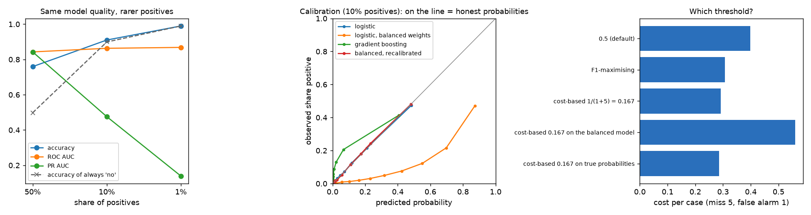
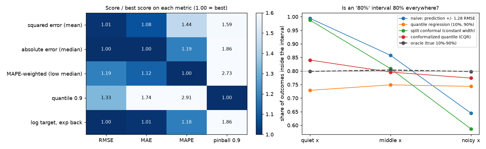
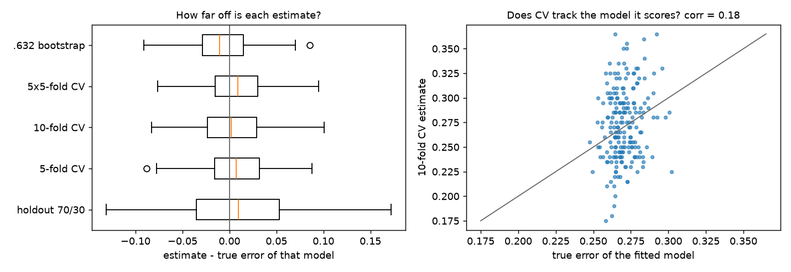
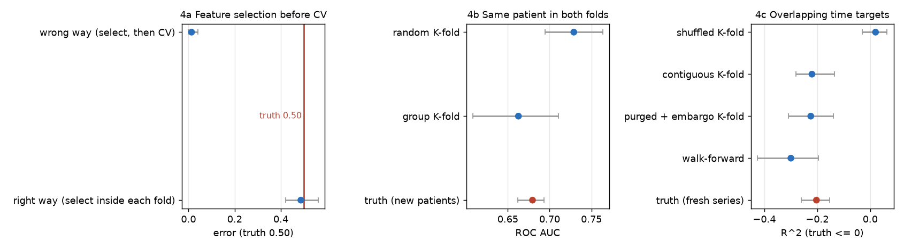
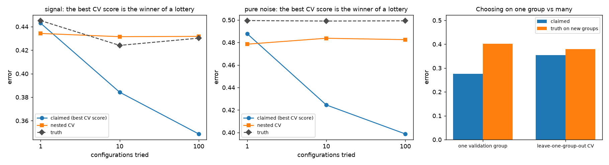
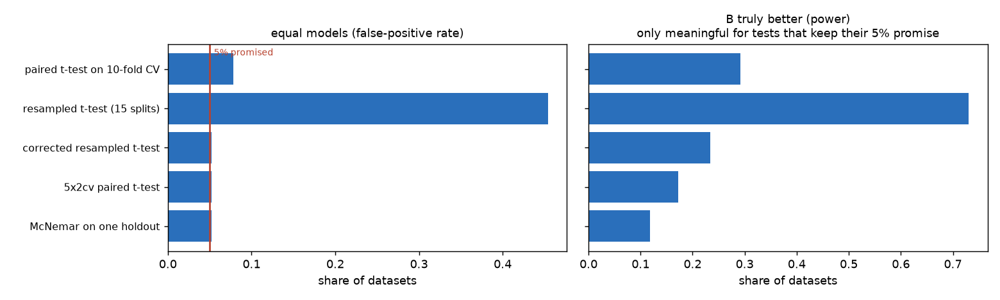
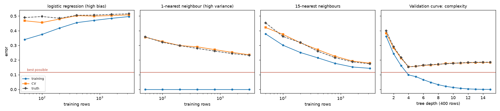
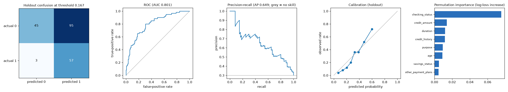

# eval-lab: how much should you trust a model's score?

Every model comes with a number: 92% accuracy, AUC 0.85, R² 0.3. This lab asks how wrong that number can be, and
**measures** it. Each lesson uses data from a generator whose truth is known, so an evaluation method's estimate
can be compared with the model's real score on 100,000 fresh examples. Most tutorials show how to call
`cross_val_score`; this one shows how far off it can be, and when.

- **Walkthrough notebook (executed):** [notebooks/walkthrough.ipynb](notebooks/walkthrough.ipynb)
- **Article:** [blog.md](blog.md)
- **Example model-quality report:** [reports/german_credit_report.md](reports/german_credit_report.md)

## The eight lessons in one table

| # | Lesson | The trap, measured |
|---|---|---|
| 1 | Classification metrics | At 1% positives the model's accuracy (99.0%) equals "always no". `class_weight="balanced"` keeps ROC AUC (0.861) but predicts 34% for a 10% event. On German credit, the 0.5 threshold costs more than rejecting every loan. |
| 2 | Regression metrics | Each metric crowns a different model; MAPE rewards forecasting low. Same error, R² 0.57 or 0.92. A naive "80%" interval covers 99% in calm regions and 65% in noisy ones. |
| 3 | CV noise | 10-fold CV is typically 3.6 points off and barely tracks the error of the model actually fitted (correlation 0.18). |
| 4 | Leakage | Feature selection before CV: 1.3% error on pure noise (truth 50%). Shuffled CV on overlapping time targets: R² +0.02, truth -0.20. |
| 5 | Tuning bias | Best of 100 configurations on pure noise: CV error 39.9%, truth 50%; nested CV 48.3%. |
| 6 | Comparing models | The resampled t-test calls two equal models different **45%** of the time (promised: 5%). |
| 7 | Learning curves | Training/CV/true error tell high bias (more data won't help) from high variance (it will). |
| 8 | Model report | All of the above in one reusable report, with an untouched holdout. |

## Lesson 1: choosing the classification metric



**Rare positives.** The same kind of problem at 50%, 10% and 1% positives:

| Positives | Accuracy (model) | Accuracy ("always no") | ROC AUC | PR AUC |
|---|---|---|---|---|
| 50% | 0.759 | 0.498 | 0.843 | 0.843 |
| 10% | 0.910 | 0.899 | 0.863 | 0.476 |
| 1% | **0.990** | **0.990** | 0.868 | **0.139** |

Accuracy can't tell the model from doing nothing. ROC AUC stays flat; PR AUC drops because precision is what
suffers when positives are rare. For rare events, report PR AUC or precision at a useful recall.

**Honest probabilities.** At 10% positives, `class_weight="balanced"` leaves ROC AUC unchanged (0.861 vs 0.862)
but inflates every probability (mean prediction 0.34 for a 0.10 event; calibration error 0.24; log loss doubles).
Only proper scores (log loss, Brier) and a calibration check see it. Isotonic recalibration on held-out data fixes it.

**Threshold from costs.** A miss costs 5, a false alarm 1, so flag when P > 1/(1+5) = 0.167:

| Threshold | Cost per case |
|---|---|
| 0.5 (default) | 0.398 |
| F1-maximising (chosen on held-out data) | 0.307 |
| **0.167 (cost-based)** | **0.292** |
| 0.167 on the balanced model | 0.560 (worst: its probabilities aren't probabilities) |
| 0.167 on the true probabilities (floor) | 0.286 |

**Real data, German credit** (1,000 loans, 30% bad; approving a bad loan costs 5, rejecting a good one 1): at 0.5,
both models cost more per loan than rejecting everyone (logistic 0.90, boosting 0.86, reject-all 0.70). At 0.167,
logistic costs 0.54.

## Lesson 2: evaluating regression



**There is no best model until you pick the metric.** A skewed target, like prices or sales. Five models, each
aimed at one metric, scored on 100,000 fresh rows (1.00 = best on that metric):

| Model trained for... | RMSE | MAE | MAPE | Pinball 0.9 | Average bias |
|---|---|---|---|---|---|
| Squared error (predicts the mean) | 1.01 | 1.08 | 1.44 | 1.59 | **+0.3 (unbiased)** |
| Absolute error (the median) | **1.00** | **1.00** | 1.19 | 1.86 | -3.5 |
| MAPE (a value below the median) | 1.19 | 1.12 | **1.00** | 2.73 | -10.4 |
| 90% quantile | 1.33 | 1.74 | 2.91 | **1.00** | +16.0 |
| Fit log y, exponentiate back | 1.00 | 1.01 | 1.18 | 1.86 | -3.3 |

- MAE rewards the median, MAPE rewards under-forecasting, pinball rewards a chosen quantile. Pick the metric from
  the cost of being wrong.
- RMSE should reward the mean model and here it tied with the median model: the best possible mean and median
  predictions differ by only 3% in RMSE, and 5,000 skewed rows can't estimate the mean that precisely.
- Median-type models under-predict by about 11% on average. If forecasts are summed (inventory, budget), only the
  mean model adds up.

**R² is not a property of the model.** Same model, same noise, same RMSE (1.00): R² **0.57** with narrow inputs,
**0.92** with wide ones.

**An "80% interval" can be 80% on average and wrong everywhere.**

| Interval | Overall | Quiet x | Middle x | Noisy x |
|---|---|---|---|---|
| Naive: prediction +/- 1.28 x RMSE | 83% | 99% | 86% | **65%** |
| Quantile regression | 74% | 73% | 75% | 74% |
| Split conformal | 79% | 99% | 81% | **59%** |
| **Conformalized quantile regression** | **80%** | 84% | 80% | 77% |
| True interval | 80% | 80% | 80% | 80% |

**Real data, California housing** (5-fold CV): the same pattern; and 992 homes sit at the $500k cap, where every
model's error is understated because the recorded price is wrong.

## Lesson 3: a cross-validation score is a noisy estimate



A logistic regression on 200 examples, 200 independent training sets; true error averaged 27.0%:

| Estimate | Average gap from the truth | Typical size of the gap | Correlation with the truth |
|---|---|---|---|
| Training error | **-6.6 points** | 3.3 | 0.15 |
| Holdout 70/30 | +1.0 | **6.1** | 0.07 |
| 5-fold CV | +0.7 | 3.6 | 0.17 |
| 10-fold CV | +0.3 | 3.6 | 0.18 |
| 5x5 repeated CV | +0.9 | 3.4 | 0.13 |
| .632 bootstrap | -0.8 | 3.2 | 0.15 |

CV is nearly unbiased but noisy, and it estimates how good the *procedure* is on average, not the model you
trained (ESL 7.12). Repeating it doesn't fix that: the noise comes from the 200 examples, not the split.

## Lesson 4: leakage, measured



| Leak | What the evaluation said | Truth |
|---|---|---|
| Choosing 100 of 5,000 noise features using all labels, *then* CV (ESL 7.10.2) | 1.3% error | **50%**; 48.7% with selection inside each fold |
| Ten records per patient, random K-fold | AUC 0.73 | **0.68** on new patients; group K-fold 0.66 |
| Overlapping 20-day targets on pure noise, shuffled K-fold | R² **+0.02** (an edge) | **-0.20** (it loses); contiguous -0.22, purged -0.22 |

**When does purging matter?** Purging drops training rows whose target window overlaps the test period. It barely
matters with 5 folds; it does with many folds and long horizons (R², pooled over all out-of-fold predictions):

| Folds | Horizon | Contiguous | Purged + embargo | Truth |
|---|---|---|---|---|
| 5 | 20 | -0.209 | -0.212 | -0.203 |
| 20 | 60 | -0.247 | -0.274 | -0.229 |
| 50 | 60 | **-0.195** (optimistic) | -0.269 | -0.229 |

(Averaging R² fold by fold, as a first version did, breaks with short test blocks: overlapping targets barely vary
inside a block. The results above pool all out-of-fold predictions.)

## Lesson 5: tuning makes the winning score optimistic



Try m configurations, keep the best CV score, report it (100 rows; 40 datasets each):

| Problem | Configurations | Best CV error (claimed) | Nested CV | Truth |
|---|---|---|---|---|
| Pure noise | 1 | 0.488 | 0.479 | 0.499 |
| Pure noise | 100 | **0.399** | 0.483 | **0.499** |
| Signal | 1 | 0.443 | 0.434 | 0.445 |
| Signal | 100 | **0.349** | 0.432 | **0.430** |

The claimed score gets better with every configuration tried, the truth doesn't (100 configurations were no better
than 10). Nested CV stays honest.

**Choosing on one validation group** (machines that each bend a shared pattern; 12 training groups, scored on 300
new ones): picking on one held-out group claims 27.5% error, the truth is 40.2%, and the choice is 3.6 points worse
than the best available. Leave-one-group-out CV claims 35.4%, truth 38.0%, regret 1.4 points.

## Lesson 6: is model B really better?



Two models equally good by construction; each test run on 500 datasets of 300 rows. Then B made truly better
(true error 33.4% vs 39.3%):

| Test | Calls equal models different (should be <= 5%) | Finds the real 6-point gap |
|---|---|---|
| Paired t-test on 10-fold CV | 7.8% | 29% |
| Resampled t-test, 15 random splits | **45%** | (meaningless) |
| Corrected resampled t-test (Nadeau and Bengio) | 5.2% | 23% |
| 5x2cv paired t-test (Dietterich) | 5.2% | 17% |
| McNemar on one holdout | 5.2% | 12% |

Repeated random splits share most of their training data, so their results aren't independent and the naive test's
variance is far too small. Even honest tests have little power at 300 rows: small datasets can't separate close
models.

## Lesson 7: will more data help?



A circular class boundary (best possible error 11.6%):
- **Logistic regression (high bias):** training and CV error meet near 50% and stay there; more data won't help.
- **1-nearest neighbour (high variance):** training error 0, CV error falls slowly (36% at 50 rows, 24% at 3,200).
- **Validation curve (tree depth):** CV error tracks the truth and picks the right depth (4); training error would
  pick the deepest tree.

## Lesson 8: a model-quality report

`report.model_report(name, models, X, y, groups=None, cost=(5, 1))` works on any scikit-learn classifier:
an untouched holdout is set aside first; a leaderboard (with a no-skill baseline) is built by CV with proper scores,
calibration, expected cost and 90% bootstrap intervals; the winner is scored once on the holdout with a confusion
matrix at the cost threshold, ROC / PR / calibration curves, permutation importance and a learning curve.

On German credit the random forest won the leaderboard at 0.515 cost per loan and cost **0.550** on the untouched
holdout (lesson 5's optimism, small here), against 0.70 for rejecting everyone.
[Full report](reports/german_credit_report.md).



## Run

```bash
pip install -r requirements-dev.txt
pytest -q
PYTHONPATH=src python -m evallab all        # every lesson, ~10 minutes on 8 cores
PYTHONPATH=src python -m evallab tuning     # or one lesson at a time (see python -m evallab --help)
```

References and what each lesson takes from them: [PRIOR_ART.md](PRIOR_ART.md).
